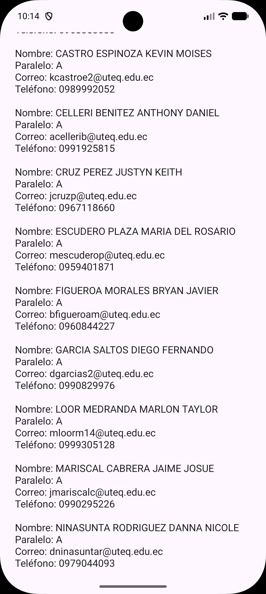

# S4 App Supabase — Escudero

Aplicación Android nativa (Kotlin + XML) desarrollada como parte de la **Guía Práctica 02** de la asignatura **Aplicaciones Móviles (ISR-602)** de la UTEQ: integración de **Supabase** con el SDK oficial para Kotlin, consultando la tabla `public.alumnos` y presentando los registros en pantalla de forma asíncrona y ordenada alfabéticamente.

## Funcionalidad

- Consulta a la tabla `alumnos` alojada en **Supabase** (PostgreSQL) mediante el SDK `postgrest-kt`.
- Listado ordenado alfabéticamente por `nombres` (A–Z) usando una corutina (`lifecycleScope`).
- Indicador de carga (`ProgressBar`) durante la consulta.
- Manejo centralizado de errores con diálogo Material Design (`SupabaseErrorHandler`).
- Cabecera con el logo de la UTEQ y título "Lista Alumnos".

## Capturas de la aplicación (emulador)

Pantalla principal con el listado de alumnos cargado desde Supabase:


Desplazamiento de la lista (scroll) mostrando más alumnos:



## Tecnologías

| Herramienta | Versión |
|---|---|
| Kotlin | 2.2.10 (integrado con AGP 9.5.1) |
| Android Gradle Plugin | 9.5.1 |
| Supabase SDK (BOM) | 3.6.0 |
| Ktor Client | 3.5.0 |
| Material Design | 1.14.0 |

## Estructura del proyecto

```
app/src/main/java/uteq/software/appsupabase/
|-- MainActivity.kt              # Consulta con corutinas y visualización
|-- data/SupabaseManager.kt      # Cliente Supabase único (Singleton)
|-- models/Alumno.kt             # Modelo @Serializable
`-- utils/SupabaseErrorHandler.kt # Diálogo de errores
```

## Configuración de credenciales

Las credenciales **no están escritas en el código**. Se leen desde `local.properties` (ignorado por Git) y se inyectan en tiempo de compilación mediante `BuildConfig`:

```properties
SUPABASE_URL=https://TU_PROYECTO.supabase.co
SUPABASE_KEY=TU_CLAVE
```

## Cómo ejecutar

1. Clonar el repositorio y abrirlo en Android Studio.
2. Crear en Supabase la tabla `alumnos` (ver guía práctica) y habilitar la política de lectura.
3. Agregar `SUPABASE_URL` y `SUPABASE_KEY` en `local.properties`.
4. Sincronizar Gradle y ejecutar en un emulador o dispositivo con internet.
